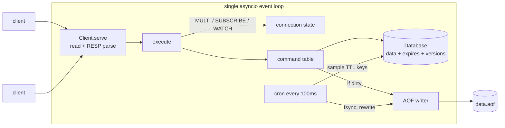

# ember

[](https://github.com/servanklc93-cmd/ember/actions/workflows/test.yml)


A Redis-compatible in-memory database written in pure Python, with no dependencies.


It speaks the real Redis wire protocol (RESP2 and RESP3), so `redis-cli`, `redis-benchmark`
and regular client libraries like `redis-py` work against it unchanged.

```
$ python -m ember --aof data.aof
$ redis-cli -p 6380
127.0.0.1:6380> SET greeting hello EX 60
OK
127.0.0.1:6380> TTL greeting
(integer) 60
127.0.0.1:6380> RPUSH queue job1 job2
(integer) 2
```

## Features

- **RESP2 + RESP3**: incremental parser that handles partial reads, pipelining and inline commands. `HELLO 3` switches a connection to RESP3, where hashes come back as maps, sets as sets, and pub/sub messages as push frames
- **55 commands** across strings, lists, hashes and sets, plus key expiry
- **Expiry** works like Redis: lazy on access, plus a background sampler that removes keys nobody reads
- **Transactions** with `MULTI` / `EXEC` / `DISCARD` and optimistic locking via `WATCH`
- **Pub/Sub** with `SUBSCRIBE`, `PSUBSCRIBE` (glob patterns) and `PUBLISH`
- **AOF persistence** with `always` / `everysec` / `no` fsync policies, automatic compaction and recovery from truncated files
- **About 60% of real Redis throughput** without pipelining (see [benchmarks](#benchmarks))

## How it works



**One thread, one event loop.** Like Redis, every command runs to completion before the
next one starts. That makes each command atomic for free, and it also makes `EXEC`
atomic: the queued commands run in a plain loop with no `await` in between, so no other
client can sneak in.

**Pipelining.** Each socket read can contain dozens of commands. The client parses all
the complete ones in the buffer, runs them, and sends every reply in a single `write()`.
Any leftover partial command stays in the buffer until the next read. That one decision
is responsible for most of the throughput.

**Expiry.** Deadlines live in a separate `expires` dict as absolute unix milliseconds.
Every read checks the deadline (lazy expiry). That alone would leak memory for keys
nobody reads again, so every 100ms the cron samples 20 keys that have a TTL, deletes the
expired ones, and repeats while more than a quarter of the sample was expired. This is
the same probabilistic algorithm Redis uses.

**WATCH.** Every mutation goes through `Database.touch(key)`, which bumps a per-key
version number. `WATCH` remembers the versions, and `EXEC` compares them. If any changed,
the transaction returns a null reply and nothing runs. `FLUSHDB` bumps a global counter,
so it invalidates every watch.

**RESP3.** Handlers return plain Python values, plus a few marker types (`Map`,
`SetReply`, `Push`) for shapes RESP3 can express. Each connection remembers which
protocol it negotiated, and the encoder chooses the wire format per connection, so
`HGETALL` is a flat array for a RESP2 client and a real map for a RESP3 one. That
mattered in practice: `redis-py` 8 sends `HELLO 3` on connect and refuses to continue
if the server can't speak RESP3.

**AOF.** After a write command runs, the server checks whether `db.dirty` changed. Only
commands that actually modified something get logged, so a `SET ... NX` that did nothing
never reaches the file. Relative expiries are rewritten before logging:

```
SET session abc EX 3600   →   SET session abc
                              PEXPIREAT session 1792485733814
```

Without this, replaying yesterday's log would give every key a fresh hour. When the file
grows past twice its post-rewrite size, ember writes a minimal snapshot to a temp file,
fsyncs it, and swaps it in with an atomic `os.replace`. If the server crashed halfway
through a write, the load step cuts off the broken tail instead of refusing to start.

## Benchmarks

`redis-benchmark`, 50 clients, on an Apple Silicon laptop. Run it yourself with `bench/run.sh`.

| command | redis 8 | ember | ember / redis |
|---|---:|---:|---:|
| SET | 193k/s | 109k/s | 56% |
| GET | 202k/s | 122k/s | 60% |
| INCR | 203k/s | 120k/s | 59% |
| LPUSH | 198k/s | 114k/s | 57% |
| LPOP | 201k/s | 120k/s | 60% |
| SADD | 204k/s | 119k/s | 58% |
| HSET | 201k/s | 104k/s | 52% |
| SET (pipeline 16) | 1.79M/s | 315k/s | 18% |
| GET (pipeline 16) | 2.30M/s | 407k/s | 18% |

Without pipelining, both servers spend most of their time waiting on the network
round trip, so Python's overhead stays partly hidden. With pipelining, the work is pure
parsing and dispatch, and that's where C pulls far ahead.

## Running

```bash
python -m ember                      # in-memory only, port 6380
python -m ember --aof data.aof       # with persistence
python -m ember --appendfsync always # fsync after every write
```

Tests:

```bash
pip install -e ".[dev]"
pytest
```

## Commands

| group | commands |
|---|---|
| strings | `GET` `SET` (EX PX EXAT PXAT NX XX GET KEEPTTL) `SETNX` `GETDEL` `MGET` `MSET` `APPEND` `STRLEN` `INCR` `DECR` `INCRBY` `DECRBY` |
| lists | `LPUSH` `RPUSH` `LPOP` `RPOP` `LRANGE` `LINDEX` `LLEN` |
| hashes | `HSET` `HMSET` `HGET` `HMGET` `HDEL` `HGETALL` `HKEYS` `HVALS` `HLEN` `HEXISTS` `HINCRBY` |
| sets | `SADD` `SREM` `SMEMBERS` `SISMEMBER` `SCARD` `SINTER` `SUNION` `SDIFF` |
| keys | `DEL` `EXISTS` `TYPE` `KEYS` `RENAME` `DBSIZE` `FLUSHDB` `FLUSHALL` |
| expiry | `EXPIRE` `PEXPIRE` `EXPIREAT` `PEXPIREAT` `TTL` `PTTL` `PERSIST` |
| transactions | `MULTI` `EXEC` `DISCARD` `WATCH` `UNWATCH` |
| pub/sub | `SUBSCRIBE` `UNSUBSCRIBE` `PSUBSCRIBE` `PUNSUBSCRIBE` `PUBLISH` |
| server | `HELLO` `PING` `ECHO` `INFO` `SELECT 0` `BGREWRITEAOF` `QUIT` `RESET` |

## Not implemented (yet)

- sorted sets, streams, `SCAN`, blocking list ops (`BLPOP`)
- ACLs / `AUTH`, replication, cluster mode
- `BGREWRITEAOF` blocks the loop. Redis forks a child for this; doing the same here would
  mean buffering writes that arrive during the rewrite and replaying them onto the new file.

## Project layout

```
ember/
  protocol.py   RESP parser / encoder
  db.py         keyspace, expiry, versions
  commands.py   command table and handlers
  server.py     asyncio server, transactions, pub/sub
  aof.py        persistence, replay, rewrite
tests/          unit + integration tests (real sockets)
bench/run.sh    redis vs ember with redis-benchmark
```

## License

MIT
